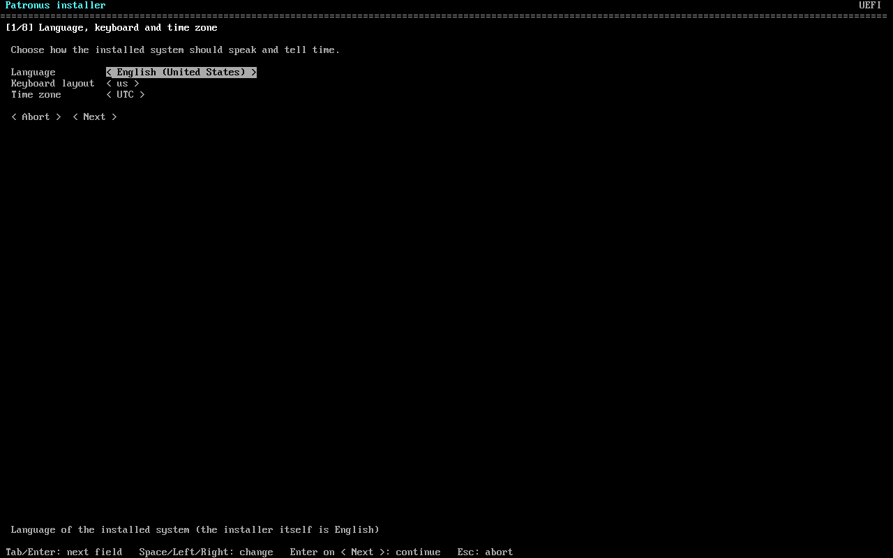
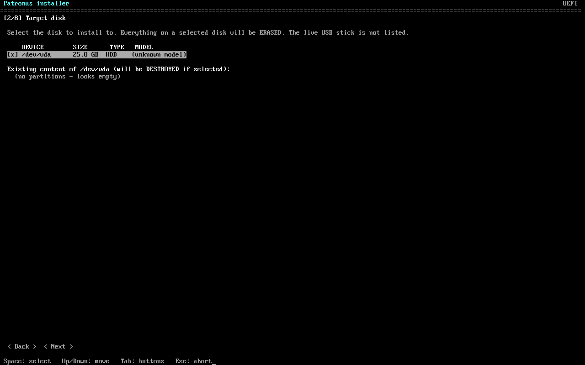
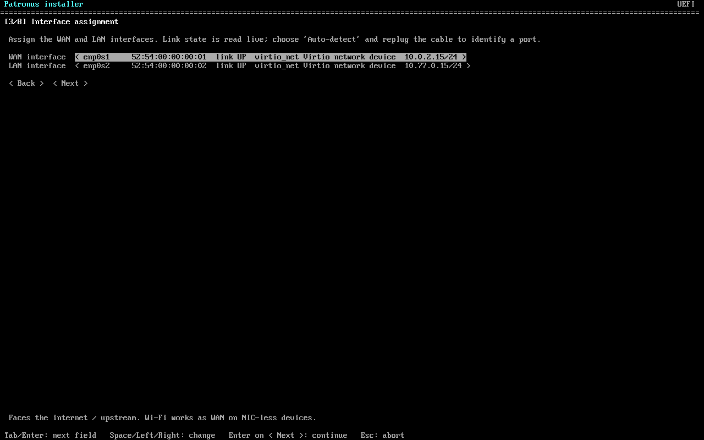
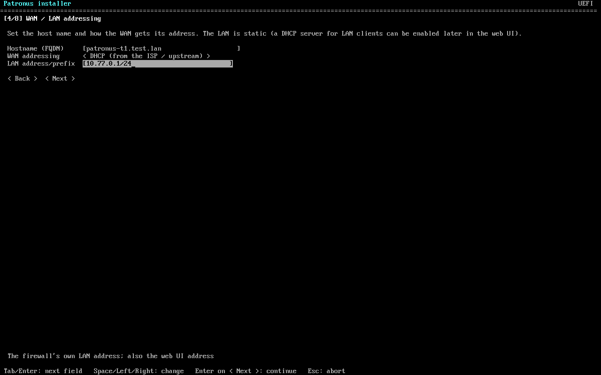
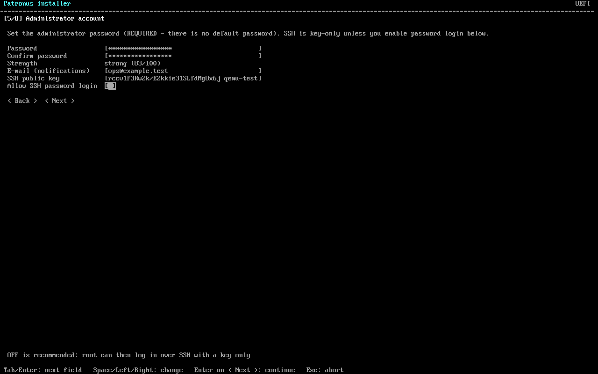
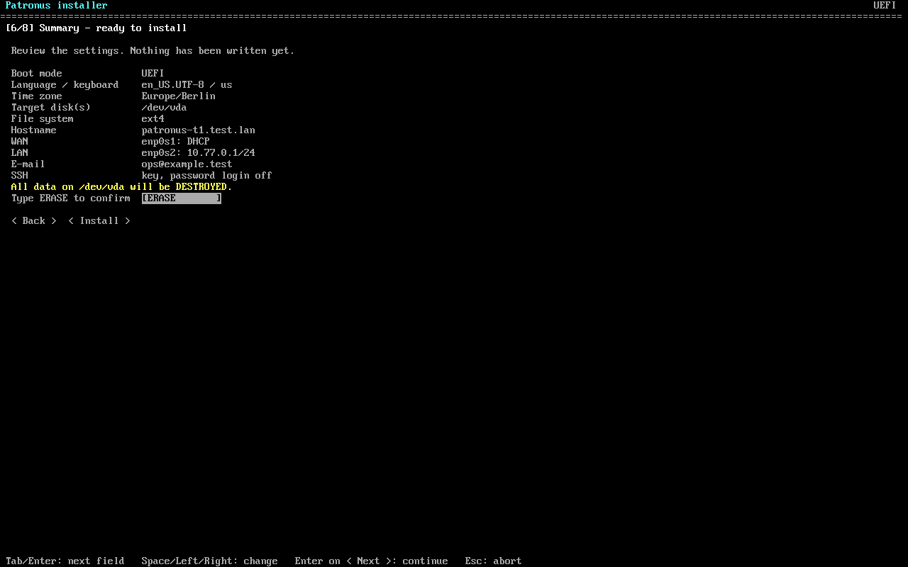
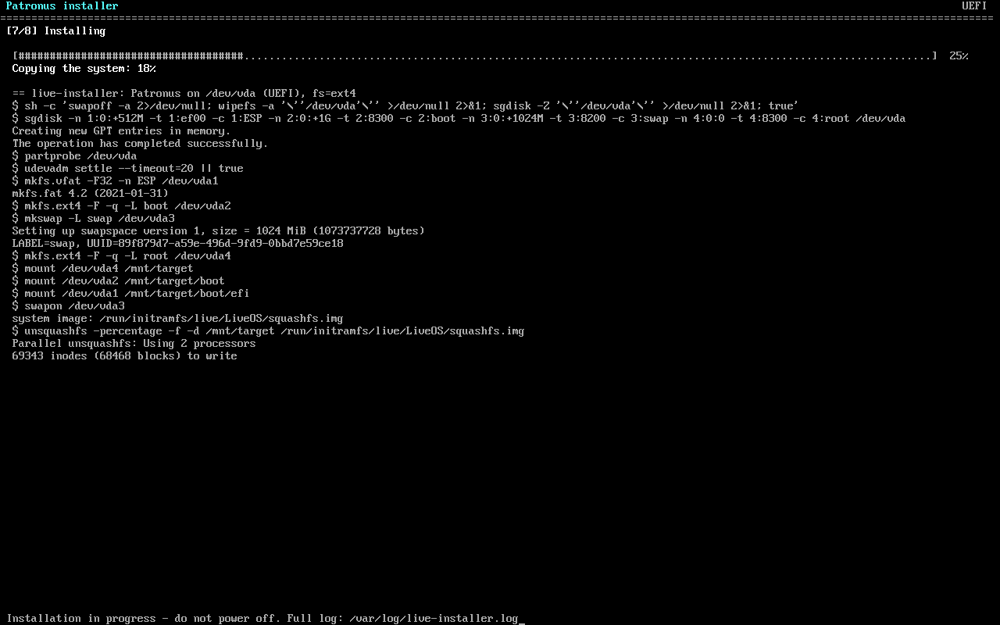
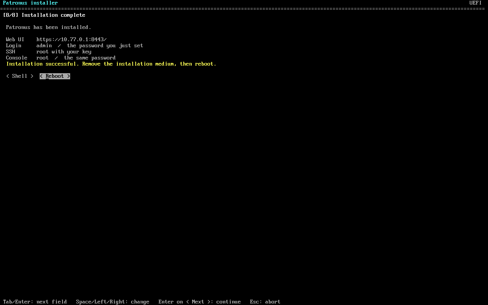
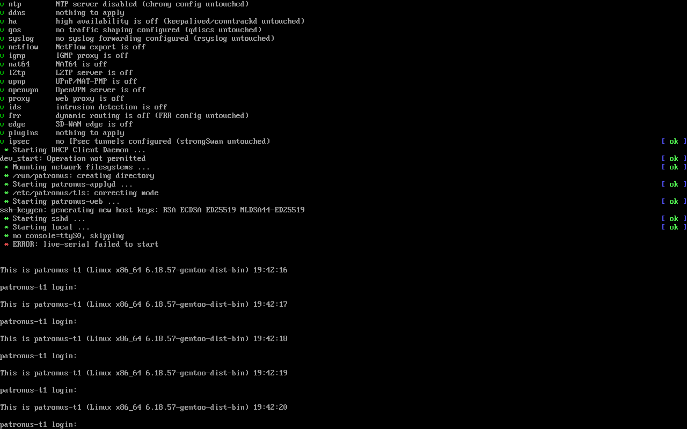
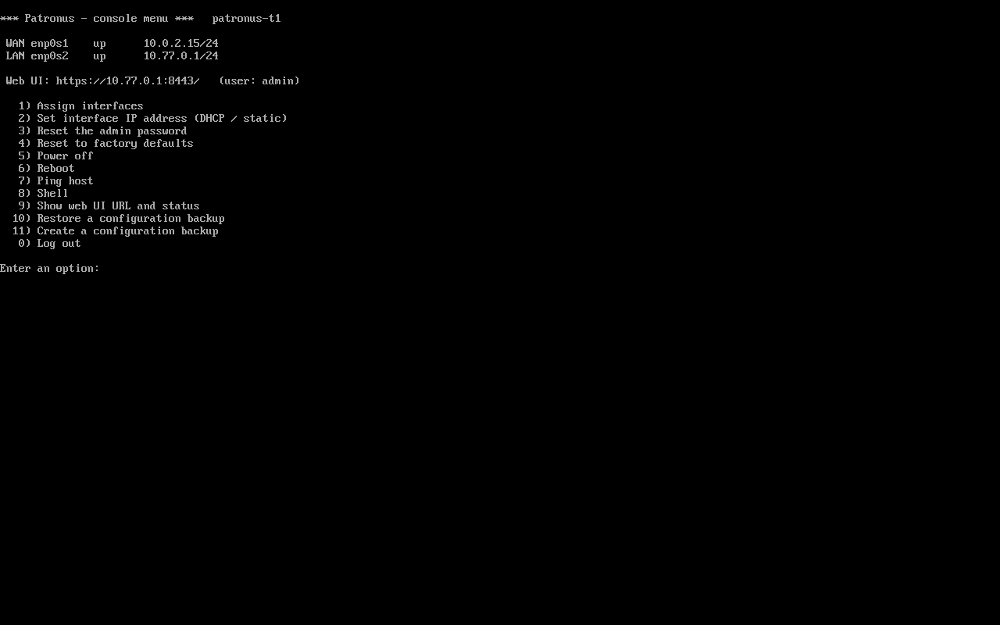

# Installing Patronus from the live ISO

Patronus ships a Gentoo-based **live + installer ISO** (x86_64, UEFI **and** legacy BIOS, hybrid:
the same file boots from a CD/VM *and* from a USB stick). It contains a **guided installer** (a text-mode wizard that works on a VGA/laptop screen and on a serial
console), an **unattended installer** driven by an answer file, and a live system you can look around in.
There is no default password anywhere: the installer makes you set one, and SSH on the installed system is
key-only unless you opt in.

## Download

| | URL |
|---|---|
| Latest **daily** test build (rolling pre-release, replaced after the QEMU test passed) | `https://git.canutethegreat.com/CanuteTheGreat/patronus/releases/download/daily/patronus-daily-x86_64.iso` |
| SHA256 of the daily | `.../releases/download/daily/patronus-daily-x86_64.iso.sha256` |
| **Stable** build (only for `v*` releases that met the criteria below) | `.../releases/download/<tag>/patronus-<tag>-x86_64.iso` |

Always verify: `sha256sum -c patronus-daily-x86_64.iso.sha256` (run it next to the downloaded files).

## Write it to a USB stick (this ERASES the stick)

Linux (replace `/dev/sdX` - check with `lsblk`; **not** a partition like `sdX1`):

    sudo dd if=patronus-daily-x86_64.iso of=/dev/sdX bs=4M conv=fsync status=progress
    sync

macOS: `diskutil list`, `diskutil unmountDisk /dev/diskN`, then
`sudo dd if=patronus-daily-x86_64.iso of=/dev/rdiskN bs=4m`.

Windows: [Rufus](https://rufus.ie) -> select the ISO -> when asked choose **"Write in DD Image mode"**
(not "ISO Image mode"), or use balenaEtcher / `dd` for Windows. Ventoy also works.

The stick is a GPT disk with an EFI System Partition plus the ISO9660 data, so it boots on UEFI
machines (via `EFI/BOOT/BOOTX64.EFI`) and on BIOS machines (GRUB in the MBR).

## Boot menu

1. **Install Patronus (guided installer)** - the default entry; starts the wizard on the screen (tty1).
2. *Install Patronus - serial console (ttyS0 115200)* - the same wizard on the serial port (headless boxes, QEMU).
3. *Automated install from an answer file (ERASES the target disk)* - see "Unattended install"; if no
   answer file is found it falls back to the guided installer.
4. *Patronus - live system (no install)*, *live system, serial console* - a root shell on the console
   (no password: physical access only; **sshd is off** and root's password is locked).
5. *Install Patronus - safe graphics (nomodeset)* - the wizard with `nomodeset` for odd GPUs.

Pick the entry with the arrow keys within 5 s, otherwise the guided installer starts.

## The guided installer

Keys: **Tab / Shift-Tab / Up / Down** move between fields, **Enter** goes to the next field (and presses the
highlighted button), **Left / Right / Space** change a choice or tick a box, in a list **type to filter**,
**Ctrl-U** clears a field, **Ctrl-L** repaints, **Esc** asks whether to abort. Nothing is written to a disk
before you type `ERASE` on the summary screen.

1. **Language, keyboard and time zone** - installed-system locale, console keymap, time zone (type to filter the list).

   

2. **Target disk** - every internal disk with model, size, bus type and its existing partitions; the USB stick you booted from is hidden.

   

3. **Interface assignment** (like OPNsense option 1) - choose the WAN and LAN interface from the list of NICs with link state, MAC and driver, or pick *Auto-detect* and unplug/replug the cable to identify a port. A Wi-Fi adapter can be the WAN (scan, SSID, passphrase) on NIC-less devices.

   

4. **WAN / LAN addressing** - host name (FQDN); WAN by DHCP or static address / gateway / DNS; the LAN address (default `192.168.1.1/24`), which is also where the web UI listens.

   

5. **Administrator account** - REQUIRED password (min. 12 characters, mixed, no guessable words; confirm; strength meter), an optional SSH public key, the notification e-mail, and the opt-in for SSH password login (off by default, with a warning when ticked). The one password protects console login (`root`) and the web UI (`admin`).

   

6. **Summary** - everything you chose; you must type `ERASE` to confirm the wipe.

   

7. **Installing** - progress bar and live log (full log: `/var/log/live-installer.log`).

   

8. **Finished** - the web UI URL, how to log in, and a *Reboot* button (remove the stick first).

   

The screenshots are real QEMU screen captures of the VGA console (`qemu-test.py --flow tui-vga`), taken by
the nightly test.

After the install: remove the stick and boot. The web UI is at `https://<ip>:8443` (self-signed
certificate; user `admin`, the password you set). The first-boot ruleset puts anti-lockout (SSH + web UI) on the LAN; the WAN drops everything inbound.

## Unattended install (answer file)

Boot the *Automated install* entry with an **answer file** available in one of two ways:

* a volume (USB stick, disk, virtual disk) whose file-system label is **`PATRONUS-ANSWERS`** (ext4, FAT or ISO9660) holding `answer.toml`; or
* the kernel argument `patronus.answers=https://server/answer.toml` (press `e` on the GRUB entry).

The file **must** carry a root password **hash** (never a plain password) and/or an SSH public key - without
either the installer refuses, because the system would be unreachable. Make a hash with
`openssl passwd -6` or `mkpasswd -m sha-512`.

```toml
[global]
keyboard = "us"
timezone = "Europe/Berlin"
hostname = "patronus-1.example.com"
email = "ops@example.com"
root_password_hash = "$6$....."          # console login; omit if you only want key login
ssh_keys = ["ssh-ed25519 AAAA... admin@laptop"]
ssh_password_auth = false                 # default false: key-only root SSH

[disk]
filesystem = "ext4"                       # ext4
disks = ["first"]                         # or ["/dev/nvme0n1"]; "first" = first internal non-USB disk >= 8 GB

[network.wan]
iface = "auto"                            # NIC name, or auto = first wired NIC with a link
mode = "dhcp"                             # or static: address / gateway / dns

[network.lan]
iface = "auto"                            # auto = the next wired NIC
address = "192.168.1.1/24"
```

The installed system's web-UI `admin` password is generated on first start into
`/var/lib/patronus/initial-admin-password` (root-readable) - read it over SSH or the console, and change it.
The installer powers the machine off when it is done (`AUTOINSTALL-OK` on the console and in
`/var/log/autoinstall.log`). Invalid answer files stop with `ANSWER-FILE-ERROR ...` lines and start the guided installer instead.

## Security defaults

* **No default password.** The live image has root locked (the consoles auto-login for physical access; **sshd is off**). The guided installer requires a password (>= 12 characters); the answer file requires a hash and/or an SSH key.
* **Installed system:** `PermitRootLogin prohibit-password` and `PasswordAuthentication no` - root can log in over SSH only with the key you gave. If you tick *Allow SSH password login* (or set `ssh_password_auth = true`) the installer sets `PermitRootLogin yes` + `PasswordAuthentication yes` and warns you.
* The web-UI admin password you type is stored only as a first-boot file that is deleted once the service is up.

## Secure Boot

**Not supported yet - turn Secure Boot OFF in the firmware setup before booting this ISO.**
The ISO uses an unsigned GRUB and an unsigned Gentoo distribution kernel; no shim/MOK chain is
shipped. With Secure Boot on, firmware will refuse `BOOTX64.EFI` ("Secure Boot violation" /
"Access Denied"). Nothing else needs to change in the firmware. The installed system is also
unsigned, so keep Secure Boot off after installing.

## Target-hardware notes

**ThinkPad 21KH (i5-1335U, 16 GB, NVMe, Intel I219 wired, UEFI)** - expected to work, **not yet tested on the real laptop**:
firmware setup (F1) -> Security -> Secure Boot -> *Disabled*; F12 for the one-time boot menu, pick the USB stick (UEFI entry).
The kernel is Gentoo's generic distribution kernel with the full `linux-firmware` set (I219 uses the in-kernel `e1000e`;
the AX211 Wi-Fi needs `iwlwifi` firmware, included; use `iwctl` (or the installer's Wi-Fi screen)). NVMe installs as `/dev/nvme0n1`.
Hybrid graphics/touchpad/suspend were not exercised; the installer image is console-only (no desktop).

**Surface Pro (gen 1, Ivy Bridge i5-3317U, 4 GB, UEFI + Secure Boot, no Ethernet)** - **not tested on the real device**:
power off, hold *Volume Down* while pressing power to boot from USB (use a USB hub/adapter for the stick);
to disable Secure Boot hold *Volume Up* while powering on -> Security -> Secure Boot -> Disabled.
The ISO is built for generic x86-64 (no AVX2 requirement), so it runs on Ivy Bridge. 4 GB RAM is enough for the live
system and installer (the live root is a RAM overlay; the 1.5 GB image is read from the stick). There is **no wired NIC**: the
installer works offline (installs from the image), but the web UI needs the network afterwards - plug a USB Ethernet
adapter or join Wi-Fi with `iwctl` (or the installer's Wi-Fi screen) (the Marvell 88W8797 `mwifiex_pcie` firmware ships in `linux-firmware`; unverified on this unit).
The Type Cover keyboard works if it presents as USB-HID (use a USB keyboard if the console does not react).

Patronus specifics: it is a firewall/router appliance. A laptop with one wired NIC needs a second (USB Ethernet) for a real WAN/LAN split; with a single port assign it as WAN and the anti-lockout rule lands there. The Surface Pro has no wired NIC: use Wi-Fi as WAN (installer Wi-Fi screen) plus a USB NIC for the LAN.

## What is tested automatically

`.forgejo/workflows/live-iso.yml` (daily, and on every `v*` tag) builds the ISO on a rw-man host and runs
`gentoo/live-iso/common/qemu-test.py` under QEMU/KVM. Five QEMU runs per build (four full installs plus the no-answer-file check):

| run | firmware / media | installer | WAN / LAN | SSH |
|---|---|---|---|---|
| 1 | BIOS + CD | answer file (unattended) | DHCP / `10.77.0.1/24` | **password opt-in** |
| 2 | BIOS + CD | guided TUI over the **serial** console (scripted keystrokes) | DHCP / `10.77.0.1/24` | key-only |
| 3 | UEFI + USB stick | guided TUI on the **VGA** console (QMP keystrokes + screenshots) | DHCP / `10.77.0.1/24` | key-only |
| 4 | UEFI + USB stick | answer file (unattended) | DHCP / `10.77.0.1/24` | key-only |
| 5 | BIOS + CD | *Automated install* entry **without** an answer file: must refuse and start the guided installer on the VGA screen; the disk stays untouched | - | - |

Every run then reboots from the installed disk alone (no ISO) and asserts:

* the live system's sshd is **off** (nothing answers on port 22 while installing);
* the old default root password (`patronus`) is **rejected** on the console, the chosen one works;
* SSH **refuses password root login** (offered auth methods are `publickey` only; a real `sshpass` attempt is refused), **accepts the configured key**, and `sshd -T` shows `permitrootlogin without-password` / `passwordauthentication no` (runs with the opt-in: password login works and the config says `yes`);
* the web UI/API answers over HTTPS **on the chosen IP** (QEMU forwards to that exact guest address; the LAN address on the second NIC, while the WAN address does not answer), the admin login works (with the password typed in the wizard, or the generated first-boot password for answer-file runs);
* host name, time zone, root file system type.

Publishing happens only when all of that passed. The run's serial logs, per-screen text captures and PNG
screenshots are attached to the release as `patronus-daily-test-evidence.tgz`. The workflow never turns the job
red on a failure (that would e-mail the owner); the result is recorded in the `daily-status` release marker instead.
Unit tests of the installer's validation rules (`common/tests`) run first.

Build it yourself on any x86_64 Docker host: `gentoo/live-iso/build.sh -o ./iso` (BuildKit required; a
first build compiles QEMU/libvirt and takes ~1 hour, cached rebuilds take minutes).

## Stable ISO criteria

A `v*` release gets a stable ISO attached (non-pre-release asset
`patronus-<tag>-x86_64.iso` + `.sha256`) only when, on the **tagged commit**:

1. the repository's own CI is not red (`failure`/`error`) for that commit;
2. the ISO builds from the tag from scratch-equivalent inputs (Gentoo stage3 + binhost, the tag's source);
3. ISO size < 2 GiB (Forgejo asset limit) and its SHA256 verifies;
4. **all five** QEMU runs above pass (both firmware types, both media types, unattended + serial wizard + VGA wizard), including the SSH/web assertions;
5. no step reported `FAIL` in the evidence bundle (attached to the release).

If any criterion fails, nothing is attached and the failure is recorded in the `daily-status` marker
(mode `stable`). The previous release stays as is. Tags must be cut by the maintainers; the workflow
never creates tags or bumps versions.

## Console menu (installed system)

After the install, the system console (VGA tty1, and the serial line `ttyS0` when the install was done from a
serial/automated boot entry) shows an OPNsense-style menu instead of a bare shell. By default the console asks for
the root password first (log in, the menu starts); tick **Open console menu** in the installer (or
`console_menu_open = true` in `answer.toml` `[global]`) for the OPNsense behaviour where anyone at the console gets
the menu without a login. tty2-6 and SSH always give a normal login shell. `touch /etc/live-installer/no-console-menu`
turns the menu off.

| Option | What it does |
|---|---|
| 1 Assign interfaces | Pick WAN and LAN (written to `/etc/patronus/patronus.toml`, firewall re-applied). Link state is shown per NIC; `d` = identify a port by unplug/replug. |
| 2 Set interface IP address | DHCP or static (address/prefix, gateway, DNS) for one NIC; Wi-Fi NICs can (re)connect through iwd. Written to `/etc/dhcpcd.conf` (managed block) and applied at once. |
| 3 Reset the admin password | Sets a new web `admin` password directly in the product's database (argon2id), drops web sessions, optionally also sets the root console password. |
| 4 Reset to factory defaults | Type `RESET` to confirm; first writes a backup, then deletes the configuration database, re-applies the product's boot units and starts it with a new password. Interface roles and addresses are kept. |
| 5 / 6 | Power off / restart the machine (asks first). |
| 7 Ping host | Validated host name or address only (no shell metacharacters). |
| 8 Shell | Root shell; `exit` returns to the menu. |
| 9 Web UI URL and status | URL, uptime, service states, root fs, effective SSH settings, latest backups. |
| 10 Restore a configuration backup | Lists `/var/backups/patronus/*.tar.gz` and `*.tar.gz` on any attached USB stick. Refuses archives of another product, with paths outside the product's config paths, or with links; takes a `pre-restore` backup first. |
| 11 Create a configuration backup | `/var/backups/patronus/patronus-config-manual-<time>.tar.gz` (consistent SQLite copy while the service runs), optionally copied to a USB stick. |

Screens (real QEMU captures from the CI run, UEFI, VGA console): the login on a protected console, then the menu.




Tests (QEMU, UEFI + BIOS, serial and VGA): the serial runs drive options 9, 7 (including a rejected `x;reboot`), 2,
3, 11, 4, 10 and 5, and log in to the web UI with the new password after each reset (the old one must fail); the VGA run
logs in on tty1 by keyboard and checks that `console-menu` is the process on tty1. Both products.

## Shared installer source

`build/live-iso/common` in Horcrux is the master; Patronus `gentoo/live-iso/common` is a vendored copy.
`sync-common.sh --write-hash` (Horcrux, after editing) records `common/TREE.sha256`; `sync-common.sh --from <horcrux checkout>`
(Patronus) copies it. CI runs `--check` in both repos (and `--upstream` in Patronus) before the unit tests, so hand edits or a
stale copy are caught.

## Known gaps

* **Secure Boot**: not supported (see above). A shim + MOK-enrolment chain (own signing key for GRUB and the kernel) is the next step.
* **Real hardware**: only QEMU/KVM (OVMF + SeaBIOS, USB-storage and CD boot) is tested automatically. The ThinkPad and Surface Pro notes above are expectations, not results. In particular untested: Wi-Fi scan/connect (needs a real adapter; the code path is exercised only by unit logic), the *Auto-detect (replug the cable)* link detection (real PHYs only), NVMe/eMMC device naming (`part_path` is unit-tested), the large console font on high-DPI panels (`setfont ter-v32n` when the framebuffer is >= 1600 px wide), touch/Type Cover input.
* The installer is text mode (curses). A graphical installer is not provided.
* Installer language: only the *installed system's* locale/keymap are selectable; the wizard text is English.
* No ZFS install for Patronus yet (ext4 only); no LVM/RAID layout.
* The notification e-mail is recorded in `/etc/patronus/notify-email`; the product does not read it yet.
* The live image has no desktop; the Portage tree is stripped from the image, so run `emerge-webrsync` before using `emerge` on a live/installed system.

## Legacy catalyst / `patronus-install` paths

The catalyst stage3/livecd scripts no longer set `root:patronus` / `patronus:patronus` (accounts are locked, sshd is `PermitRootLogin prohibit-password` + `PasswordAuthentication no`), and `patronus-install` writes `PasswordAuthentication no` and refuses a plaintext user password shorter than 12 characters.
